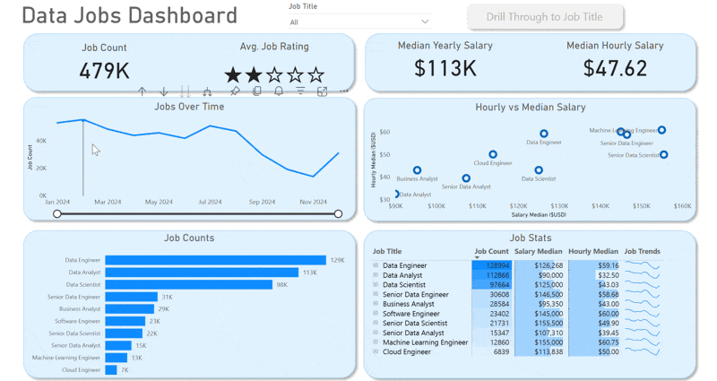
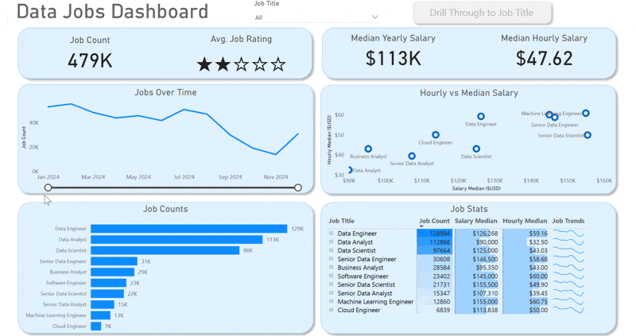
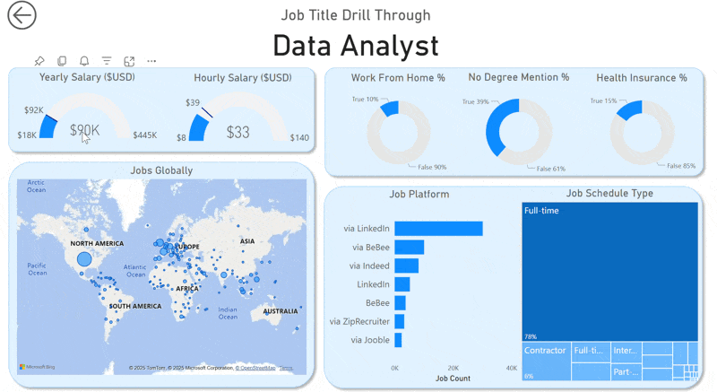

# Project 1: Data Jobs Dashboard

> 📊 **[View the interactive dashboard on Power BI Service](https://app.powerbi.com/view?r=eyJrIjoiZGM0ZWI2NjctZTY2NC00NGYyLWE4YzUtYWE4ZWJiZTg2NzZlIiwidCI6ImY4NDIyNTYzLTFhMTMtNGEzYy1iZjQ1LWZkOGIxZmZhNmY0ZSIsImMiOjl9)**

## Introduction

Information about the data job market is scattered and hard to piece together. I built this dashboard for **job seekers, career changers and people switching jobs** so they can explore it in one place. It uses a real dataset of 2024 data job postings, with job titles, salaries and locations, to show market trends and pay.

📂 **Dashboard file:** [`Data_Jobs_Dashboard.pbix`](Data_Jobs_Dashboard.pbix)

## Skills Showcased

- **⚙️ Power Query (ETL):** cleaned and prepared the raw data by handling blanks, fixing data types and adding new columns
- **🧮 Measures:** calculated KPIs such as `Median Yearly Salary` and `Job Count`
- **📊 Core charts:** column, bar, line and area charts to compare job counts and track trends over time
- **🗺️ Maps:** map charts showing where the jobs are around the world
- **🔢 KPIs and tables:** cards for headline numbers and sortable tables for detail
- **🎨 Dashboard design:** a clean, intuitive layout using both common and less common chart types
- **🖱️ Interactivity:**
  - **Slicers:** filter the report by job title
  - **Buttons and bookmarks:** move between views
  - **Drill-through:** go from the summary page to details for one job title

## Dashboard Overview

The report has two pages: a market summary and a detailed analysis.

### Page 1: Market Overview

A quick view of the data job market, with KPIs such as total job count, median salaries and the top job titles.

### Page 2: Job Title Drill-Through

Drill through from the overview to see one job title in detail: salary ranges, work-from-home share, top hiring platforms and a world map of job locations.

## Conclusion

This dashboard turns raw job posting data into a tool for career research. Users can slice, filter and drill into the data to make informed decisions about their careers.
