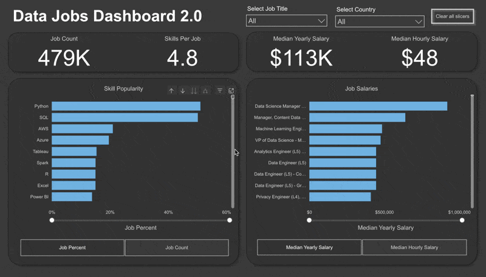
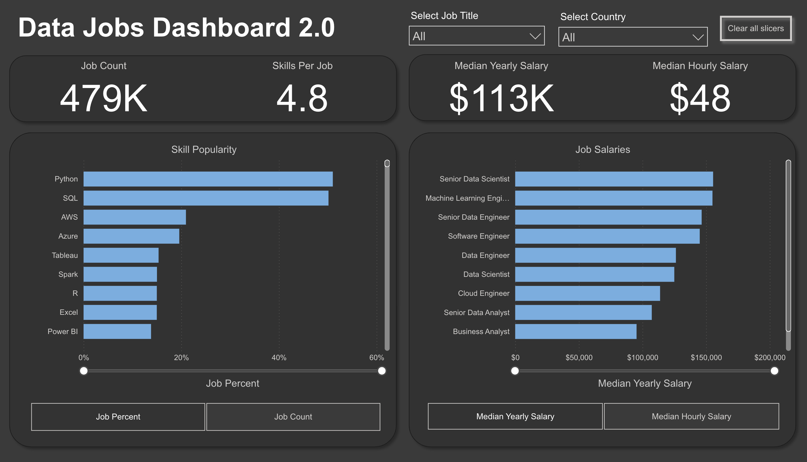

# Project 2: Data Jobs Dashboard 2.0

> 📊 **[View the interactive dashboard on Power BI Service](https://app.powerbi.com/view?r=eyJrIjoiMTQ0YzNhMWYtNTY4NS00MWMyLWI0NmMtYWM3ZWE5OWFjNTI4IiwidCI6ImY4NDIyNTYzLTFhMTMtNGEzYy1iZjQ1LWZkOGIxZmZhNmY0ZSIsImMiOjl9)**

## Introduction

The data job market can feel like a maze. Version 2.0 of my dashboard redesigns the report as a **single page** that gives **job seekers, career changers and people switching jobs** the key market and pay insights at a glance. It uses the same real dataset of 2024 data job postings, with job titles, salaries, locations and skills.

📂 **Dashboard file:** [`Data_Jobs_Dashboard_2.0.pbix`](Data_Jobs_Dashboard_2.0.pbix)

## Skills Showcased

- **🎨 Dashboard design:** an intuitive single-page layout
- **⚙️ Power Query (ETL):** data cleaning, shaping and transformation
- **🔗 Data modeling:** relationships between tables following star-schema principles
- **🧮 DAX:** calculations and aggregations for the key metrics
- **📊 Visualizations:**
  - **📈 Core charts:** column, bar, line and area charts for comparisons and trends
  - **🗺️ Maps:** geographic data
  - **🔢 Cards:** headline KPIs
  - **📋 Tables:** detailed data
- **🖱️ Interactivity:**
  - **🎚️ Slicers:** filter the data
  - **🔘 Buttons and bookmarks:** switch between views

## Dashboard Overview

The single page shows these KPIs:

- **Job Count**
- **Skills Per Job**
- **Median Yearly Salary**
- **Median Hourly Salary**

It also shows **skill popularity** (as a percentage of jobs or as a job count) and compares **salaries across job titles**.

## What Changed from Version 1

| Version 1 | Version 2.0 |
|-----------|-------------|
| Two pages (overview + drill-through) | One focused page |
| Single flat table | Star-schema data model |
| Implicit measures | DAX measures |
| Job and salary focus | Adds skill analysis (skills per job, skill popularity) |

## Conclusion

Version 2.0 turns a large set of job postings into a fast, focused tool. On one page, job seekers can filter the market and find what they need to plan their next career move.
