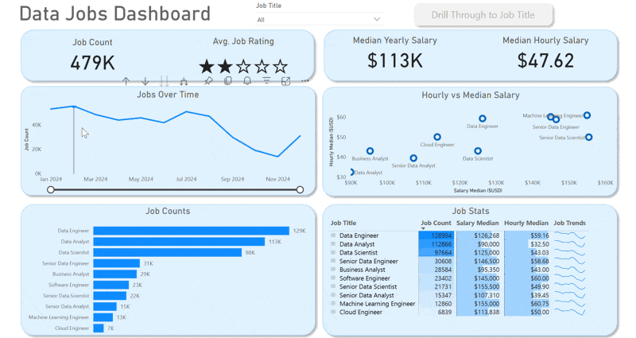

# 📊 Data Jobs Dashboards — Power BI

## About

This repository holds two Power BI dashboards that analyze the **2024 data job market**: data analysts, data engineers, data scientists and related roles. They help **job seekers, career changers and people switching jobs** answer questions like:

- Which data roles have the most openings?
- What do these roles pay (yearly and hourly)?
- Which skills do employers ask for most?
- Where are the jobs, and how many are remote?

The data is a real dataset of 2024 data job postings, including job titles, salaries, locations, skills, hiring platforms and work-from-home flags.

## 📁 Projects

| # | Project | Description | File |
|---|---------|-------------|------|
| 1 | [Data Jobs Dashboard](Project_1_Data_Jobs_Dashboard/) | Two-page report: a market overview plus a drill-through page for each job title | [`Data_Jobs_Dashboard.pbix`](Project_1_Data_Jobs_Dashboard/Data_Jobs_Dashboard.pbix) |
| 2 | [Data Jobs Dashboard 2.0](Project_2_Data_Jobs_Dashboard_2.0/) | Single-page redesign with a star-schema data model, DAX measures and skill analysis | [`Data_Jobs_Dashboard_2.0.pbix`](Project_2_Data_Jobs_Dashboard_2.0/Data_Jobs_Dashboard_2.0.pbix) |

## 🛠️ Skills Showcased

- **Power Query (ETL):** cleaning, shaping and transforming raw data
- **Data modeling:** relationships following star-schema principles
- **DAX:** measures for KPIs such as median salary, job count and skills per job
- **Visualization:** column, bar, line, area and map charts, cards and tables
- **Interactivity:** slicers, buttons, bookmarks and drill-through
- **Dashboard design:** clear layouts that tell a story with the data

## 🚀 How to Use

1. Install [Power BI Desktop](https://powerbi.microsoft.com/desktop/) (free).
2. Clone or download this repository.
3. Open a `.pbix` file from one of the project folders.

## 🙏 Acknowledgments

I built these dashboards while following the [Power BI for Data Analytics course](https://github.com/lukebarousse/PowerBI_Data_Analytics_Course) by Luke Barousse, which also provides the dataset.

## 📬 Contact

**Muhammad Atif** — [GitHub](https://github.com/atifkhan215)
